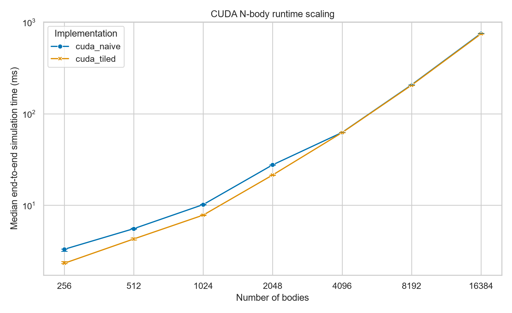
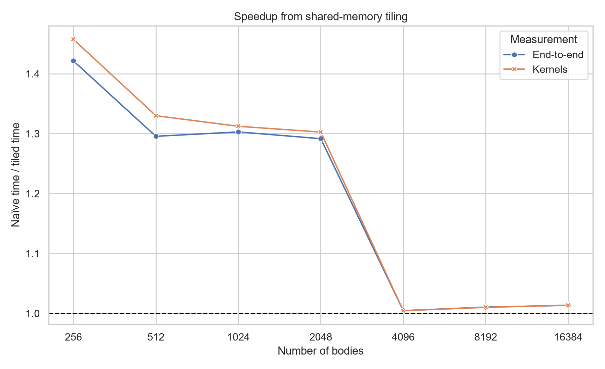
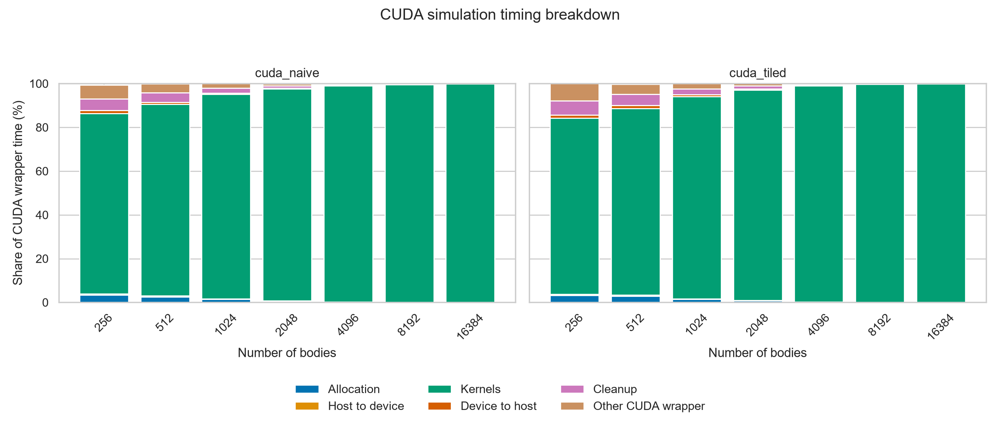
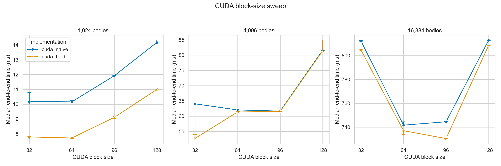
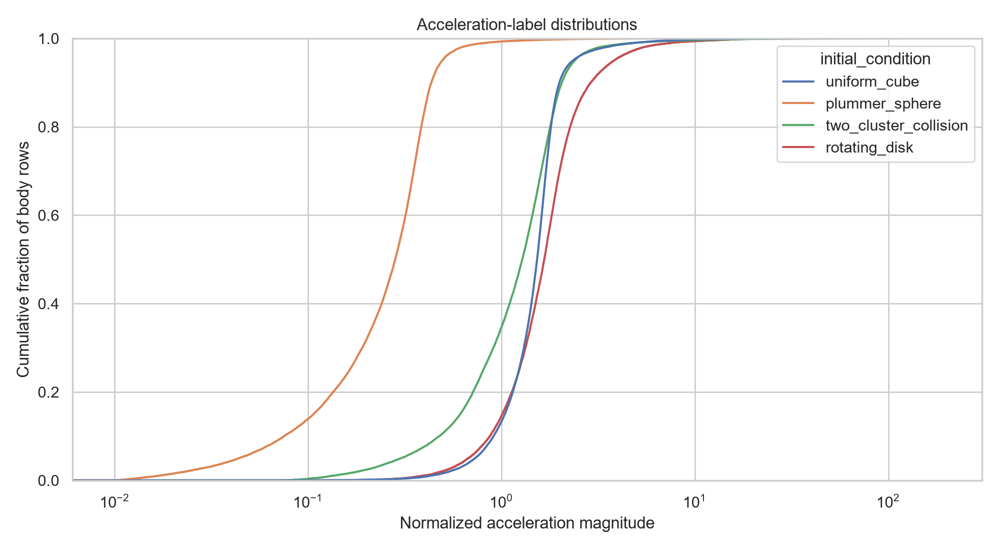
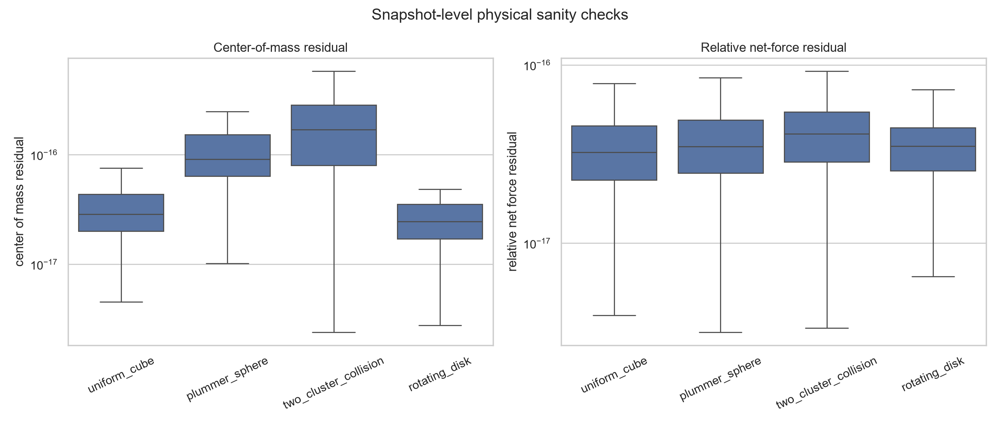
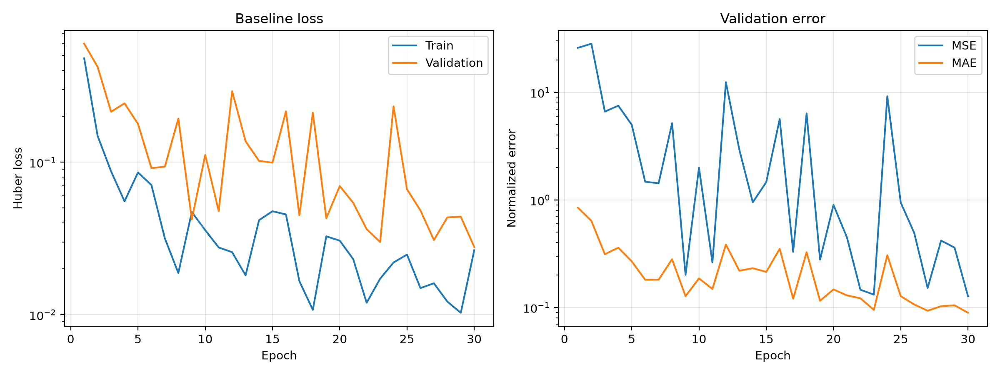

# CUDA N-Body Simulation and Machine-Learned Force Approximation

This project studies the performance of gravitational N-body simulation on CPUs and GPUs and asks whether a machine-learning surrogate can eventually approximate the expensive all-pairs force calculation. The exact direct method requires every body to interact with every other body, so one force evaluation is O(N²). The project currently has working naïve and shared-memory-tiled CUDA implementations, a velocity-Verlet integrator, performance analysis tools, four initial-condition families, and a complete candidate ML dataset pipeline.

The serial CPU, OpenMP CPU, and learned-force model are the main remaining components. Until an independent serial FP64 implementation validates a representative sample of the generated labels, the dataset is deliberately described as a **candidate dataset**, not a frozen final dataset.

## Research questions

The completed and planned work is organized around four questions:

1. At what particle count does exact CUDA become faster than exact serial and OpenMP CPU implementations?
2. How much does shared-memory tiling improve the CUDA force calculation?
3. Can a sparse hierarchical model predict each body's acceleration accurately without explicitly evaluating every pair?
4. If the learned model is accurate enough, is its complete preprocessing and inference pipeline actually faster than exact CPU or CUDA force evaluation?

The ML model must reduce the number of interactions. A neural network applied to every particle pair would remain O(N²) and would likely do more work than the analytical gravity equation.

## Current status

| Component | Status |
|---|---|
| Deterministic body initialization | Implemented and tested |
| Uniform-cube initial conditions | Implemented and tested |
| Plummer-like sphere | Implemented and tested |
| Two-cluster collision | Implemented and tested |
| Rotating disk | Implemented and tested |
| Naïve FP64 CUDA force calculation | Implemented and tested |
| Shared-memory tiled FP64 CUDA force calculation | Implemented and tested |
| CUDA velocity-Verlet integration | Implemented and tested |
| Detailed CUDA timing and benchmark CSV output | Implemented |
| CUDA scaling and block-size analyses | Completed on the development machine |
| Candidate ML dataset generation and loading | Implemented; dataset generated locally |
| PyTorch tensor, batching, and DataLoader pipeline | Implemented and tested |
| Small-N fully connected force baseline | Implemented, trained, and evaluated |
| Serial CPU force calculation | Not implemented yet |
| OpenMP force calculation | Not implemented yet |
| CPU/GPU crossover analysis | Waiting for serial/OpenMP implementations |
| Hierarchical learned-force model | Planned, not implemented |
| CUDA labels validated against independent CPU FP64 | Waiting for serial implementation |

## Physical and numerical model

For each body `i`, the direct solver evaluates the softened gravitational acceleration

```text
a_i = G * sum(j != i) m_j * (r_j - r_i)
      / (|r_j - r_i|^2 + epsilon^2)^(3/2)
```

The code uses normalized units with `G = 1`, FP64 state and force calculations, configurable softening `epsilon`, and velocity-Verlet time integration. Softening prevents singular accelerations during extremely close encounters.

Two exact GPU backends are available:

- `cuda_naive`: each GPU thread evaluates one target body and reads all source bodies from global memory.
- `cuda_tiled`: source bodies are loaded into shared-memory tiles and reused by every thread in a block.

Both methods still perform O(N²) arithmetic. Tiling changes memory reuse and constant factors, not asymptotic complexity.

## Requirements

### CUDA-enabled build

- An NVIDIA GPU supported by the installed CUDA toolkit
- NVIDIA display/compute driver
- CUDA toolkit, including `nvcc`
- CMake 3.20 or newer
- A C++17 compiler supported by the installed CUDA toolkit
- Python 3 with `venv` for analysis and dataset preparation

The completed local experiments used:

- Windows `10.0.26200`
- NVIDIA GeForce RTX 3060 Laptop GPU, 6 GB, compute capability 8.6
- CUDA toolkit 12.8
- NVIDIA driver 595.97
- Visual Studio 2022/MSVC through MSBuild 17.14
- CMake 4.4.4
- Python 3.13.1

Runtime measurements are machine-specific. New hardware should rerun the benchmark scripts instead of treating the included timings as universal.

### Windows installation

Install the following before configuring the project:

1. Visual Studio 2022 with the **Desktop development with C++** workload and a Windows SDK.
2. CMake, with `cmake` available in PowerShell.
3. The NVIDIA driver and CUDA toolkit. The CUDA installer must be able to find a supported Visual Studio C++ toolset.
4. Python 3.

Verify the main tools:

```powershell
cmake --version
nvcc --version
nvidia-smi
python --version
```

If CMake reports `No CUDA toolset found`, first verify that `nvcc --version` works, then confirm that Visual Studio's C++ workload was installed and that the CUDA toolkit supports that compiler version. Delete or use a new CMake build directory after fixing the installation so CMake performs CUDA detection again.

### Linux or a cluster such as CARC

Load site-provided compiler, CUDA, CMake, and Python modules. Exact module names vary by cluster, so inspect the available versions first:

```bash
module spider cuda
module spider cmake
module spider gcc
```

Then load a mutually compatible set, for example:

```bash
module load gcc
module load cuda
module load cmake
module load python
```

The files `scripts/run_cpu.slurm` and `scripts/run_gpu.slurm` are templates. Before submitting them, add the correct CARC account, partition/constraint, and module commands. The CPU job will not run a simulation until the serial/OpenMP backends are implemented.

## Get the code and Python environment

From PowerShell in the repository root:

```powershell
python -m venv .venv
.\.venv\Scripts\Activate.ps1
python -m pip install --upgrade pip
python -m pip install -r requirements.txt
python -m pip install -r requirements-ml.txt
```

On Linux/macOS:

```bash
python3 -m venv .venv
source .venv/bin/activate
python -m pip install --upgrade pip
python -m pip install -r requirements.txt
python -m pip install -r requirements-ml.txt
```

The base dependencies are pandas, matplotlib, seaborn, and PyArrow. The separate ML requirements file installs the official PyTorch 2.11 CUDA 12.8 build used by this project; it is a large download. For a CPU-only machine or a different CUDA runtime, use the command produced by the [official PyTorch installation selector](https://pytorch.org/get-started/locally/) instead.

## Build

### Windows CUDA build

The scripts in this repository expect the Windows build directory to be named `build-cuda-explicit`:

```powershell
cmake -S . -B build-cuda-explicit -DNBODY_ENABLE_CUDA=ON
cmake --build build-cuda-explicit --config Release
```

The executables are written to:

```text
build-cuda-explicit/Release/nbody.exe
build-cuda-explicit/Release/nbody_generate_dataset.exe
```

### Linux CUDA build

```bash
cmake -S . -B build-cuda -DCMAKE_BUILD_TYPE=Release -DNBODY_ENABLE_CUDA=ON
cmake --build build-cuda --parallel
```

### CPU-only build

A CPU-only configuration can build the shared infrastructure and initialization tests:

```powershell
cmake -S . -B build
cmake --build build --config Release
```

The `serial` and `openmp` command-line choices currently report that CPU simulation is not implemented. A CPU-only build is therefore not yet a usable simulation backend.

## Run the tests

Windows:

```powershell
ctest --test-dir build-cuda-explicit -C Release --output-on-failure
```

Linux:

```bash
ctest --test-dir build-cuda --output-on-failure
```

The current suite contains four CTest targets:

- deterministic default initialization;
- deterministic, finite, centered initial-condition families with unit total mass and zero net momentum;
- naïve CUDA analytical one- and two-body forces, a non-block-aligned 257-body case, velocity-Verlet motion, and timing validation;
- tiled CUDA analytical and 257-body comparisons against naïve CUDA, including block sizes 64 and 256.

At the time of this README update, all four tests pass.

## Run a simulation

Example tiled CUDA run on Windows:

```powershell
.\build-cuda-explicit\Release\nbody.exe `
    --implementation cuda_tiled `
    --bodies 4096 `
    --steps 100 `
    --dt 0.001 `
    --epsilon 0.01 `
    --seed 12345 `
    --block-size 64 `
    --repetitions 5
```

Use `cuda_naive` to select the naïve kernel. The program performs a one-step warmup, runs the requested number of timed repetitions, reports the median end-to-end time, and prints the first body's final position.

Append each repetition and its timing breakdown to a CSV file with `--output`:

```powershell
.\build-cuda-explicit\Release\nbody.exe `
    --implementation cuda_tiled `
    --bodies 4096 `
    --steps 10 `
    --repetitions 5 `
    --block-size 64 `
    --output results\my_cuda_run.csv
```

The detailed timing columns are allocation, host-to-device transfer, CUDA kernels, device-to-host transfer, cleanup, CUDA-wrapper total, and outer end-to-end time. Run `nbody.exe --help` for all options.

## CUDA performance experiments

### Methodology

The finalized local scaling experiment used both CUDA implementations with:

- `N = 256, 512, 1024, 2048, 4096, 8192, 16384`;
- 10 velocity-Verlet steps per timed simulation;
- one warmup simulation before measurement;
- five measured repetitions per configuration;
- median end-to-end runtime as the primary result;
- fixed seed 12345, `dt = 0.001`, and `epsilon = 0.01`; and
- CUDA block size 64.

End-to-end time includes allocation, transfers, kernel execution, result retrieval, and cleanup. It is therefore more representative than kernel-only timing.

### Scaling results

| Bodies | Naïve median (ms) | Tiled median (ms) | Naïve / tiled speedup |
|---:|---:|---:|---:|
| 256 | 3.307 | 2.327 | 1.421x |
| 512 | 5.554 | 4.287 | 1.296x |
| 1,024 | 10.178 | 7.812 | 1.303x |
| 2,048 | 27.655 | 21.412 | 1.292x |
| 4,096 | 62.480 | 62.191 | 1.005x |
| 8,192 | 206.973 | 204.818 | 1.011x |
| 16,384 | 754.738 | 744.672 | 1.014x |



The tiled kernel produced a 1.29x-1.42x end-to-end speedup from 256 through 2,048 bodies. On this RTX 3060 Laptop GPU the advantage nearly disappeared at 4,096 bodies and above. This shows that shared-memory tiling is helpful, but not automatically better by a large factor at every problem size or on every GPU.



### Timing breakdown



At small N, allocation, cleanup, transfers, and wrapper overhead are visible portions of total time. Kernel execution becomes dominant as N grows: for both implementations it accounts for more than 98% of CUDA-wrapper time by N = 4096 and about 99.8% by N = 16384. This is why transfer optimization alone cannot solve the large-N O(N²) cost.

### CUDA block-size sweep

The refined sweep tested block sizes 32, 64, 96, and 128 at N = 1024, 4096, and 16384, with five repetitions per point.



The fastest block size was not universal:

| Implementation | N = 1,024 | N = 4,096 | N = 16,384 |
|---|---:|---:|---:|
| Naïve | 64 | 96 | 64 |
| Tiled | 64 | 32 | 96 |

Block size 64 remains the project default because it is a simple common setting, was best at N = 1024 for both methods, and performed well at the largest tested size. It is not claimed to be optimal for every N; performance-sensitive experiments should sweep block size on the target GPU.

### Reproduce the CUDA analysis

Run the standard scaling matrix:

```powershell
.\scripts\run_cuda_benchmarks.ps1
```

The script appends to `results/cuda_optimized_scaling.csv`; move or remove an existing file first if a clean experiment is required. Generate the published-style summary and plots:

```powershell
.\.venv\Scripts\python.exe .\scripts\plot_results.py `
    --input results\cuda_optimized_scaling.csv `
    --summary-output results\cuda_optimized_scaling_summary.csv `
    --output visualization\output\cuda_optimized_scaling.png `
    --breakdown-output visualization\output\cuda_optimized_timing_breakdown.png `
    --speedup-output visualization\output\cuda_optimized_tiled_speedup.png
```

Reproduce the refined block-size sweep and plot:

```powershell
.\scripts\run_cuda_block_sweep.ps1 `
    -BodyCounts 1024,4096,16384 `
    -BlockSizes 32,64,96,128 `
    -Steps 10 `
    -Repetitions 5 `
    -OutputPath results\cuda_block_sweep_refined.csv `
    -Overwrite

.\.venv\Scripts\python.exe .\scripts\plot_block_sweep.py `
    --input results\cuda_block_sweep_refined.csv `
    --summary-output results\cuda_block_sweep_refined_summary.csv `
    --best-output results\cuda_block_sweep_refined_best.csv `
    --output visualization\output\cuda_block_sweep_refined.png
```

The final raw measurements, summaries, and plots used above are versioned in `results/` and `visualization/output/`. Other generated experiment files remain ignored by Git.

## Candidate ML dataset

### Purpose

The learned model will receive a complete particle state and predict the acceleration `(ax, ay, az)` of every body. The current direction is a sparse hierarchical graph or hybrid near-field/far-field model; a fully connected GNN would preserve the O(N²) interaction count and is only suitable as a small-N baseline.

The dataset labels are exact direct-summation FP64 accelerations from tiled CUDA. Selected snapshots are checked against naïve FP64 CUDA during generation. All sampled comparisons in the completed candidate generation had a maximum naïve/tiled acceleration difference of zero.

### Initial-condition families

- `uniform_cube`: random positions in a cube with small random velocities;
- `plummer_sphere`: a truncated Plummer-like spherical distribution;
- `two_cluster_collision`: two separated Plummer-like clusters moving toward each other; and
- `rotating_disk`: a thin rotating disk used only as a held-out-family test.

Each generated system has positive equal masses summing to one, a centered center of mass, and zero net momentum.

### Fixed dataset matrix

The complete matrix is stored in `ml/dataset_matrix.json`.

| Split/evaluation | Families | Particle counts | Trajectories per family/count |
|---|---|---|---:|
| Train | cube, Plummer, two-cluster | 128, 256, 512, 1024, 2048 | 10 |
| Validation: unseen seeds | cube, Plummer, two-cluster | 128, 256, 512, 1024, 2048 | 2 |
| Test: interpolation counts | cube, Plummer, two-cluster | 768, 1536 | 4 |
| Test: extrapolation count | cube, Plummer, two-cluster | 3072 | 4 |
| Test: held-out family | rotating disk | 256, 1024, 2048 | 4 |

Every trajectory contributes eight snapshots separated by 25 integration steps. Seeds and complete trajectories are disjoint across splits, preventing temporal leakage.

The generated candidate contains:

- 228 trajectories;
- 1,824 snapshots;
- 1,765,376 body rows;
- 1,200 training snapshots;
- 240 validation snapshots; and
- 384 test snapshots.

On the development machine, the raw CSV shards occupy about 596 MB and the compressed Parquet copy about 143 MB. Dataset files are ignored by Git and must be generated locally.

### Preview or edit the matrix

Preview the work without generating anything:

```powershell
.\.venv\Scripts\python.exe .\ml\generate_full_dataset.py --dry-run
```

Edit `ml/dataset_matrix.json` to change families, particle counts, trajectory counts, seeds, snapshot spacing, or physical parameters. Keep seed ranges disjoint.

### Generate the raw dataset

Build the CUDA project first, then run:

```powershell
.\.venv\Scripts\python.exe .\ml\generate_full_dataset.py
```

On Linux, override the Windows-oriented default generator path:

```bash
.venv/bin/python ml/generate_full_dataset.py \
    --generator build-cuda/nbody_generate_dataset
```

For a rerun that replaces existing shards:

```powershell
.\.venv\Scripts\python.exe .\ml\generate_full_dataset.py --overwrite
```

The raw output is written to:

```text
data/raw/candidate_v1/
├── manifest.csv
├── metadata.json
└── one CSV file per split/evaluation/family shard
```

Generate only one split with `--only-split train`, `--only-split validation`, or `--only-split test`. Run `ml/generate_full_dataset.py --help` for path overrides.

### Validate and prepare the model-ready dataset

```powershell
.\.venv\Scripts\python.exe .\ml\prepare_full_dataset.py
```

Use `--overwrite` when replacing an existing processed dataset. The preparation step checks:

- expected row counts;
- required columns and finite numeric values;
- positive masses and characteristic scales;
- family consistency;
- unique trajectory/snapshot/body keys;
- complete snapshots; and
- body IDs exactly covering `0` through `N-1`.

It then writes compressed Parquet shards and supporting metadata:

```text
data/processed/candidate_v1/
├── train/
├── validation/
├── test/
├── manifest.csv
├── metadata.json
├── normalization.json
└── snapshot_index.parquet
```

### Normalization

With characteristic radius `R`, total mass `M`, and `G = 1`, the loader applies:

```text
position     / R
velocity     / sqrt(M / R)
mass         / M
acceleration / (M / R^2)
epsilon      / R
```

Empirical means and standard deviations after physical scaling are fitted using the training split only and stored in `normalization.json`. Validation and test data never influence these statistics.

### Explore and sanity-check the dataset

Run the complete exploratory analysis after preparing the Parquet dataset:

```powershell
.\.venv\Scripts\python.exe .\ml\analyze_dataset.py
```

The analysis validates all numeric rows, summarizes normalized position, velocity, acceleration, and softening distributions, measures center-of-mass, momentum, and net-force residuals for every snapshot, and examines representative and maximum-acceleration close encounters. It writes tables and a Markdown report to `results/dataset_analysis/` and plots to `visualization/output/dataset_analysis/`.

The current candidate passed all finite-value and completeness checks. Across 1,824 snapshots, the maximum normalized center-of-mass residual was `2.33e-15`, the maximum relative momentum residual was `1.05e-15`, and the maximum relative net-force residual was `2.58e-16`. These are consistent with FP64 roundoff.



The acceleration targets are strongly family-dependent and heavy-tailed. Median normalized magnitudes range from about 0.28 for Plummer-like spheres to 1.73 for the held-out rotating disks. The largest target is about 267.6 in a two-cluster training example. Maximum-acceleration snapshot checks associate the extreme labels with close encounters, so they should not simply be discarded; a robust loss or deliberate sample weighting should be tested during training.



### Load variable-size PyTorch batches

`NBodyTorchDataset` converts complete snapshots to tensors. `make_dataloader` concatenates variable-size systems without padding and returns `batch_index` and `ptr` arrays that preserve the exact system boundaries:

```python
import torch

from ml.torch_dataset import make_dataloader

loader = make_dataloader(
    "data/processed/candidate_v1",
    split="train",
    normalize=True,
    max_snapshots=4,
    max_particles=4096,
)

device = torch.device("cuda" if torch.cuda.is_available() else "cpu")
for batch in loader:
    inputs = batch["node_features"].to(device, non_blocking=True)
    targets = batch["accelerations"].to(device, non_blocking=True)
    batch_index = batch["batch_index"].to(device, non_blocking=True)
    ptr = batch["ptr"]
    break
```

The default node features are normalized `(x, y, z, mass)`. Velocities are still returned separately for integration but are excluded from force-model inputs because Newtonian acceleration does not depend on velocity. Set `include_velocity_features=True` only for an explicit ablation study.

The particle budget prevents a batch containing several large systems from unexpectedly exhausting GPU memory. Batches stay within one Parquet shard, and each shard's batches remain contiguous so the loader can reuse its one-shard cache. Training still shuffles the shard order and the snapshots within each shard. At the start of each epoch, call `loader.batch_sampler.set_epoch(epoch)` to obtain a deterministic new order.

Filter test cases with `evaluation_group="interpolation_counts"`, `"extrapolation_count"`, or `"held_out_family"`. Verify the complete tensor pipeline with:

```powershell
.\.venv\Scripts\python.exe -m unittest discover -s tests -p test_torch_dataset.py -v
```

### Small-N pairwise baseline

`PairwiseForceBaseline` is a fully connected, rotation-equivariant correctness baseline. It learns a scalar radial interaction from softened distance, multiplies it by source mass, and sums the resulting displacement messages for each target body. It is translation invariant and rotation equivariant, but still evaluates all directed pairs and remains O(N²); it is not the proposed scalable model.

Train the default baseline on N=128 snapshots from the three training families:

```powershell
.\.venv\Scripts\python.exe .\ml\train_baseline.py --epochs 30
```

Training uses FP32, Huber loss, AdamW, cosine learning-rate decay, unseen-seed validation, and best-checkpoint selection. The completed RTX 3060 run used 240 training and 48 validation snapshots and finished in about 105 seconds. The best checkpoint was epoch 30:

| Evaluation | MSE | MSE / zero predictor | MAE | Mean relative vector error | Mean direction cosine |
|---|---:|---:|---:|---:|---:|
| Unseen seeds, N=128 | 0.1272 | 0.484% | 0.0892 | 13.79% | 0.99787 |
| Unseen count N=768, trained families | 0.00794 | 0.796% | 0.0482 | 12.07% | 0.99923 |
| Held-out rotating disk, N=256 | 0.6658 | 7.50% | 0.4551 | 28.24% | 0.99640 |



The model learns acceleration direction very well, but close encounters make magnitude errors and per-epoch MSE volatile. The held-out disk is substantially harder than unseen seeds or unseen N from trained families, confirming that this split tests genuine distribution shift.

Reproduce the evaluations with:

```powershell
.\.venv\Scripts\python.exe .\ml\evaluate_baseline.py `
    --split validation --body-counts 128 `
    --output results\ml_baseline\validation_metrics.csv

.\.venv\Scripts\python.exe .\ml\evaluate_baseline.py `
    --split test --evaluation-group interpolation_counts --body-counts 768 `
    --output results\ml_baseline\interpolation_768_metrics.csv

.\.venv\Scripts\python.exe .\ml\evaluate_baseline.py `
    --split test --evaluation-group held_out_family --body-counts 256 `
    --output results\ml_baseline\heldout_disk_256_metrics.csv
```

The best checkpoint is saved locally under `results/ml_baseline/best_model.pt` and remains ignored by Git. Configuration, history, summaries, and evaluation tables are retained.

### Dataset validation status

The current metadata says:

```text
status: pre_serial_validation
serial_validated: false
```

Naïve and tiled CUDA agreement is useful but not fully independent because both implementations run on CUDA and share project data structures. Once the serial FP64 backend is available, a stratified sample covering all families, particle counts, and splits must be compared against it before the dataset is frozen for final ML experiments.

## Repository layout

```text
.
├── CMakeLists.txt
├── include/nbody/              C++ data structures and public APIs
├── src/
│   ├── cuda/                   naïve and tiled CUDA implementations
│   ├── generate_dataset.cpp    CUDA acceleration-label writer
│   ├── initial_conditions.cpp  four deterministic system families
│   └── main.cpp                simulation and benchmark executable
├── tests/                      initialization and CUDA correctness tests
├── scripts/
│   ├── run_cuda_benchmarks.ps1
│   ├── run_cuda_block_sweep.ps1
│   ├── plot_results.py
│   ├── plot_block_sweep.py
│   └── *.slurm                 cluster job templates
├── ml/
│   ├── dataset_matrix.json     fixed candidate experiment matrix
│   ├── generate_full_dataset.py
│   ├── prepare_full_dataset.py
│   ├── analyze_dataset.py      EDA and physical sanity checks
│   ├── torch_dataset.py        PyTorch tensors and variable-N batching
│   ├── baseline_model.py       O(N²) equivariant accuracy baseline
│   ├── train_baseline.py       training and checkpoint selection
│   ├── evaluate_baseline.py    per-family/count evaluation
│   ├── prepare_dataset.py      earlier small-pilot splitter
│   └── dataset.py              Parquet snapshot loader
├── results/                    selected versioned results; other output ignored
├── visualization/output/       selected versioned plots; other output ignored
└── data/                       generated locally and ignored by Git
```

## Known limitations and next steps

1. Implement and analytically test the serial FP64 force calculation and velocity-Verlet simulation.
2. Implement OpenMP and measure scaling across thread counts.
3. Compare serial, OpenMP, naïve CUDA, and tiled CUDA to find the CPU/GPU crossover point.
4. Validate a representative sample of CUDA dataset labels against serial FP64 and freeze a versioned final dataset.
5. Build a small learned-force baseline using the completed PyTorch input pipeline, followed by a sparse hierarchical or hybrid exact-near/learned-far model.
6. Evaluate one-step acceleration error, unseen-N and held-out-family generalization, rollout stability, energy drift, momentum drift, and end-to-end inference time.
7. If time permits, compare against Barnes-Hut so the learned approximation is evaluated against a strong classical O(N log N) method, not only direct summation.

Any ML speedup claim must include graph construction, preprocessing, transfers, and inference. Kernel-only ML timing must not be compared with end-to-end exact-solver timing.
