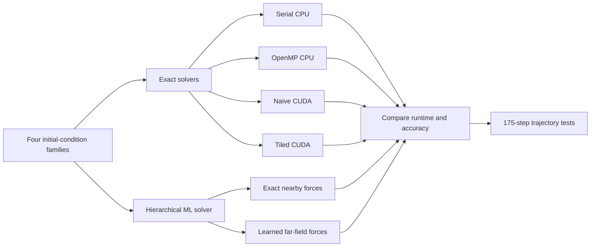
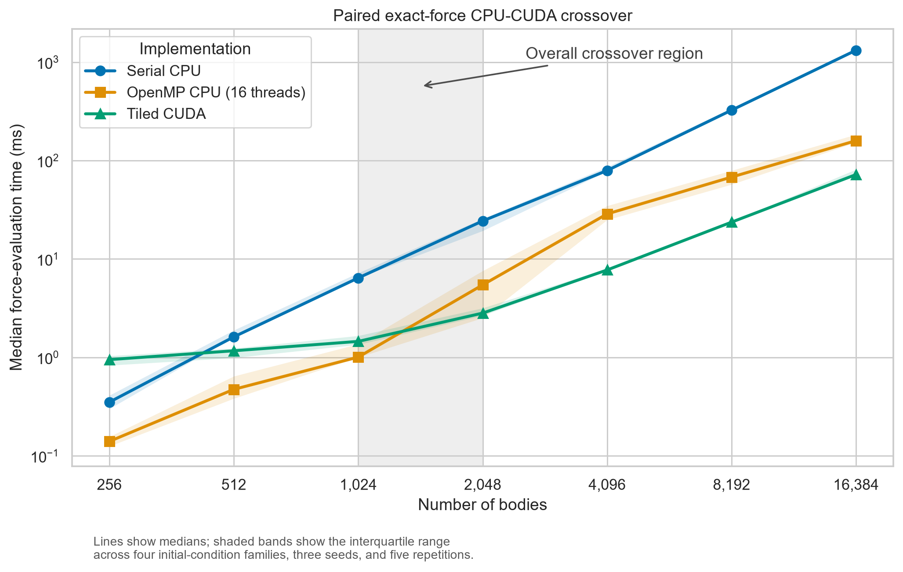
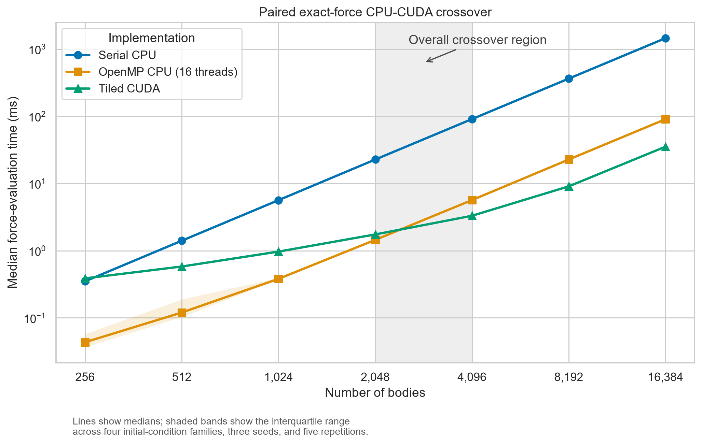
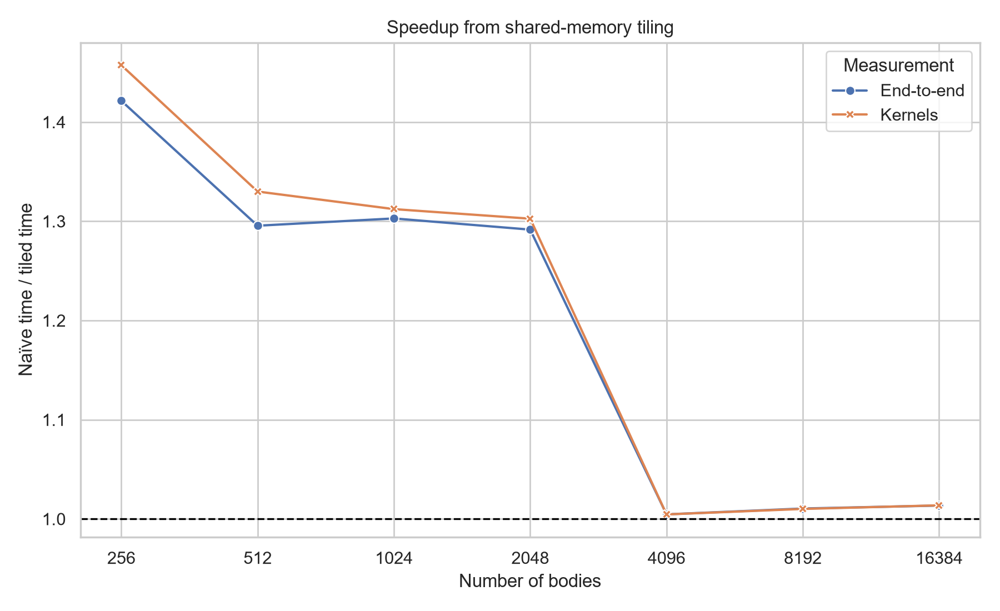
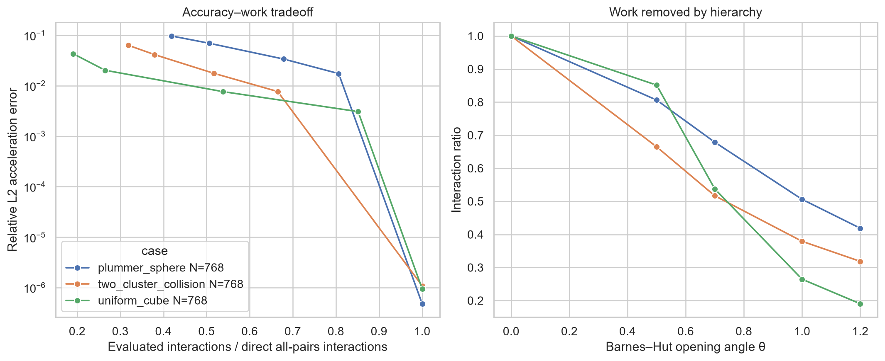
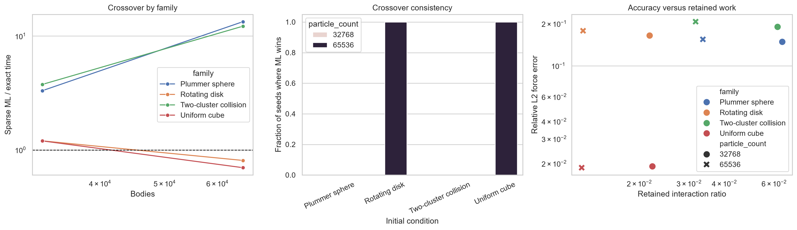
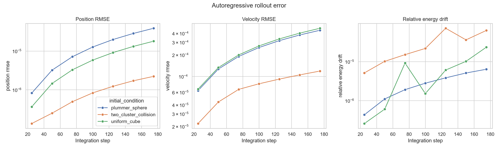

# Accelerating N-Body Simulations with CPUs, CUDA, and Machine Learning

This project studies how to make gravitational N-body simulations faster. The
exact method calculates the force between every pair of bodies, so its cost
grows as **O(N²)**. We compare exact CPU and CUDA implementations, then test
whether a hierarchical machine-learning model can reduce the number of force
calculations while keeping useful accuracy.

> This README is a short presentation of the project. Full installation,
> reproduction commands, implementation details, and complete experiment
> results are in [project_overview.md](project_overview.md).

## Project questions

1. When does a GPU become faster than serial and parallel CPU code?
2. How much does a shared-memory tiled CUDA kernel improve performance?
3. Can machine learning avoid evaluating every pairwise force?
4. Does the ML speedup remain accurate across different physical systems?

## Method

The exact solvers use FP64 softened gravity and velocity-Verlet integration.
The final experiments use four deterministic system families:

- uniform cube;
- Plummer-like sphere;
- two-cluster collision; and
- rotating disk.

The ML solver builds an octree. Nearby bodies are still calculated exactly,
while distant groups are replaced by a learned center-of-mass interaction. The
opening angle `theta` controls the tradeoff: a larger value removes more work
but usually increases error.

## Finding 1: the CPU-GPU crossover depends on the hardware

A CPU sweep selected **16 OpenMP threads** as the best local CPU configuration.
The final paired benchmark used identical states, three seeds per family, five
timed repetitions, CUDA block size 64, and body counts from 256 to 16,384.

| Bodies | Serial CPU | OpenMP CPU | Tiled CUDA | Fastest |
|---:|---:|---:|---:|---|
| 256 | 0.351 ms | **0.140 ms** | 0.950 ms | OpenMP |
| 1,024 | 6.423 ms | **1.007 ms** | 1.454 ms | OpenMP |
| 2,048 | 24.362 ms | 5.456 ms | **2.820 ms** | CUDA |
| 16,384 | 1,321.438 ms | 159.313 ms | **72.093 ms** | CUDA |

**Local result:** the overall OpenMP-to-CUDA crossover is between **N=1,024 and
N=2,048** on the development laptop. At N=16,384, tiled CUDA is **2.21x faster
than OpenMP** and **18.33x faster than serial CPU**.

The crossover is also system-dependent. The first tested CUDA win occurs at
N=1,024 for the uniform cube, N=2,048 for the Plummer sphere and rotating disk,
and N=4,096 for the two-cluster collision.

The same paired experiment was repeated on USC CARC using an **NVIDIA A40** and
an **AMD EPYC 7282** CPU. The CARC run used the same four families, seeds,
repetitions, 16 OpenMP threads, and CUDA block size 64.

| Bodies | Serial CPU | OpenMP CPU | Tiled CUDA | Fastest |
|---:|---:|---:|---:|---|
| 256 | 0.350 ms | **0.043 ms** | 0.387 ms | OpenMP |
| 1,024 | 5.643 ms | **0.381 ms** | 0.969 ms | OpenMP |
| 2,048 | 22.715 ms | **1.448 ms** | 1.745 ms | OpenMP |
| 4,096 | 90.795 ms | 5.661 ms | **3.305 ms** | CUDA |
| 16,384 | 1,452.204 ms | 90.427 ms | **35.282 ms** | CUDA |

**CARC result:** the crossover moves to between **N=2,048 and N=4,096**, with
the first CUDA win at N=4,096 for all four families. At N=16,384, the A40 is
**2.56x faster than 16-thread OpenMP** and **41.16x faster than serial CPU**.
This confirms the expected crossover while showing that its location is not a
universal particle count.

## Finding 2: CUDA tiling helps most at smaller sizes

The shared-memory tiled kernel reuses source-body data within each CUDA block.
Block size **64** was the best tested default.

**Result:** tiling improved the earlier 10-step CUDA benchmark by about
**1.29x–1.42x** from N=256 through N=2,048. At N=4,096 and above, the measured
advantage was small on this GPU. Tiling improves constants, but both exact CUDA
kernels still perform O(N²) work.

## Finding 3: the hierarchy trades force calculations for error

The hierarchical model can replace many distant particle-particle interactions
with a single learned aggregate interaction.

At N=768:

- `theta=0.7` retained about **52%–68%** of the direct interactions with
  **0.77%–3.38%** relative force error.
- `theta=1.2` retained about **19%–42%** of the interactions, but error increased
  to **4.32%–9.69%**.

**Result:** the model does reduce the O(N²) force workload, especially as N
grows, but removing more interactions produces a clear accuracy cost.

## Finding 4: ML speedup depends strongly on the physical system

The large-N paired experiment compares the complete sparse-ML pipeline with
the complete exact tiled-CUDA force calculation. A value below 1 means ML is
faster.

At the conservative `theta=0.7` setting and N=65,536:

| Initial condition | ML / exact time | Relative force error | Interpretation |
|---|---:|---:|---|
| Uniform cube | **0.70x** | **1.86%** | Faster with low error |
| Rotating disk | **0.81x** | 17.78% | Faster, but inaccurate |
| Plummer sphere | 13.37x | 15.44% | Slower and inaccurate |
| Two-cluster collision | 12.21x | 20.66% | Slower and inaccurate |

Concentrated systems create deeper, more irregular trees. They retain more
near-field interactions and cause greater CUDA traversal divergence, so the
same model behaves very differently across families.

At the aggressive `theta=1.0` setting, the guarded model became faster than
exact CUDA for every family at N=65,536, but only the uniform cube kept low
force error:

| Initial condition | ML / exact time | Relative force error |
|---|---:|---:|
| Uniform cube | **0.28x** | **2.27%** |
| Rotating disk | **0.34x** | 25.65% |
| Plummer sphere | **0.70x** | 11.38% |
| Two-cluster collision | **0.66x** | 12.43% |

**Result:** a broad runtime crossover exists at large N, but a broad
**accuracy-and-speed crossover does not**.

## Finding 5: exact-near interactions improve trajectory stability

The learned acceleration is inserted into velocity-Verlet and compared with
exact CUDA trajectories for 175 steps. A zero-net-force correction prevents
spurious center-of-mass acceleration.

| Evaluation | Final position RMSE | Relative energy drift |
|---|---:|---:|
| Validation families, N=128 | **1.96e-5** | **3.09e-5** |
| Held-out rotating disk, N=256 | 1.55e-4 | 2.98e-4 |

The hierarchical rollout is much more accurate than the fully learned O(N²)
baseline because nearby interactions remain exact. The held-out disk remains
the hardest case, showing that generalization is still the main limitation.

## Conclusions

1. **OpenMP is best for small problems; tiled CUDA wins as N grows.** The
   measured crossover was 1,024–2,048 bodies on the laptop and 2,048–4,096 on
   the CARC A40 node.
2. **The hierarchical ML method successfully removes force calculations**, and
   the fraction of removed work improves as the simulation grows.
3. **ML can beat exact CUDA at large N**, but the result depends strongly on the
   particle distribution and opening angle.
4. **Speed alone is not enough.** The fastest configuration can have
   unacceptable force and trajectory error.
5. The current result is a **measured performance–accuracy tradeoff**, not a
   universal replacement for exact N-body simulation.

## Verification

- All **5/5 C++ and CUDA tests** pass.
- All **29/29 Python and ML tests** pass.
- A stratified sample of **84 CUDA-generated force labels** passed independent
  serial FP64 validation. The maximum scaled difference was `1.73e-15`.

The local timings were measured on an NVIDIA GeForce RTX 3060 Laptop GPU with
CUDA 12.8. The independent CARC run used an NVIDIA A40, an AMD EPYC 7282 CPU,
and CUDA 12.6. The different crossover regions demonstrate why crossover
points must be remeasured on each system.

## More information

See [project_overview.md](project_overview.md) for installation, build and test
instructions, dataset generation, complete experiment tables, reproduction
commands, repository layout, and limitations.
